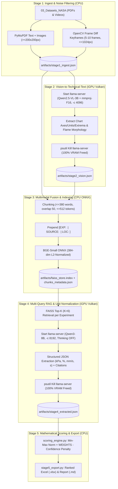

# ARCHITECTURE SPECIFICATION — FLAME IN FREEFALL (NASA HACKATHON)

## 1. System Overview & Hardware Envelope
- **Target System**: Local Edge AI Workstation (CPU + AMD Radeon 860M iGPU via Vulkan + ONNX Runtime).
- **Execution Paradigm**: Strictly sequential 5-stage pipeline with deterministic process lifecycle management (`psutil` + `try...finally`) to guarantee 100% RAM/VRAM reclamation between heavy model stages.
- **Root Directories**:
  - Models: `D:\MCN\Hackathon_NASA_AI\01_Models_Weights\`
  - Runtimes: `D:\MCN\Hackathon_NASA_AI\02_Runtime_Engines\`
  - Datasets: `D:\MCN\Hackathon_NASA_AI\03_Datasets_NASA\`
  - Source Code & Artifacts: `D:\MCN\Hackathon_NASA_AI\04_Source_Code\`

---

## 2. Model Architecture & Operational Specifications

| Role | Model Artifact | Architecture & Precision | Runtime & Mandatory Flags | Key Constraints |
| :--- | :--- | :--- | :--- | :--- |
| **Stage 2: Vision (VLM)** | `Qwen2.5-VL-3B-Instruct-Q4_K_M.gguf` + `mmproj-F16.gguf` | Multimodal Dynamic-Resolution ViT (FP16 projector preserves chart text & flame edges) + 3B LLM core (Q4_K_M) | `llama-server.exe -m <model> --mmproj <mmproj> -ngl 99 -c 4096 --port 8080` (`temperature=0.1`) | Input image longest edge `<= 1024px` (Base64 OpenAI Vision API) |
| **Stage 3 & 4: Embedding** | `bge-small-en-v1.5` (`model_optimized.onnx`) | BERT Bi-Encoder on ONNX Runtime (`fastembed` local path) | CPU ONNX Runtime, L2-normalized `float32` vectors | `MAX_SEQ_LEN = 512` tokens, `EMBED_DIM = 384`, `faiss.IndexFlatIP(384)` |
| **Stage 4: Reasoning (LLM)** | `Qwen3-8B-Q4_K_M.gguf` | Dense Transformer 8B (36 layers, Grouped-Query Attention - GQA for low KV-cache footprint, Q4_K_M ~4.68 GB) | `llama-server.exe -m <model> -ngl 99 -c 8192 --port 8080 --chat-template-kwargs "{\"enable_thinking\": false}"` (`temperature=0.1`) | Strict Pydantic JSON Schema (`response_format={"type": "json_object", "schema": ...}`) + `/no_think` |

---

## 3. Sequential Execution & Memory Reclamation Flow

---

## 4. Stage-by-Stage Data Contracts (Input / Output)

### Stage 1: `stage1_ingest.py`
- **Input**: Raw files in `03_Datasets_NASA\raw_pdfs\` and `03_Datasets_NASA\raw_videos\` (grouped by `experiment_id`).
- **Processing**:
  - PDFs: Extract text per page (`page_number`), extract embedded images only if `width >= 200` and `height >= 200`, resize longest side to `<= 1024px`.
  - Videos: Compute normalized grayscale histogram/frame difference to select `5` to `10` peak state-transition keyframes (ignition, steady spherical flame, extinction), record `timestamp_sec`, resize longest side to `<= 1024px`.
- **Output Contract** (`04_Source_Code\artifacts\stage1_ingest.json`):
  - List of experiment bundles containing `experiment_id`, `text_blocks` (`source_file`, `loc`, `text`), and `visual_assets` (`source_file`, `loc`, `image_path`, `asset_type`, `width`, `height`).

### Stage 2: `stage2_vision.py`
- **Input**: `04_Source_Code\artifacts\stage1_ingest.json`.
- **Processing**:
  - Spawns `llama-server.exe` with `Qwen2.5-VL-3B-Instruct-Q4_K_M.gguf` and `--mmproj mmproj-F16.gguf`.
  - Prompts VLM to extract X/Y axes, units, min/max values for charts, or flame color, spherical symmetry, soot/re-ignition phenomena for flame images.
  - Terminates `llama-server.exe` in `finally` block using `psutil`.
- **Output Contract** (`04_Source_Code\artifacts\stage2_vision.json`):
  - List of `VisualDescription` records preserving `experiment_id`, `source_file`, `page_or_sec`, `image_path`, and `technical_description`.

### Stage 3: `stage3_index.py`
- **Input**: `stage1_ingest.json` + `stage2_vision.json`.
- **Processing**:
  - Merges PDF text blocks and VLM technical descriptions.
  - Chunks text with `chunk_size <= 380` words (`overlap = 50`), strictly verifying token count `<= 512` tokens via BGE tokenizer.
  - Prepends mandatory citation header: `[EXP: <id> | SOURCE: <file> | LOC: <page/sec>]`.
  - Computes 384-dim L2-normalized `float32` embeddings via `bge-small-en-v1.5` (`fastembed` offline mode) and indexes into `faiss.IndexFlatIP(384)`.
- **Output Contract**:
  - `04_Source_Code\artifacts\nasa_flame.index` (FAISS binary index)
  - `04_Source_Code\artifacts\chunks_metadata.json` (List of chunk metadata + text)

### Stage 4: `stage4_rank.py`
- **Input**: `nasa_flame.index`, `chunks_metadata.json`.
- **Processing**:
  - Queries FAISS per `experiment_id` across domain queries to gather Top-K (`K = 6`) high-density chunks.
  - Spawns `llama-server.exe` with `Qwen3-8B-Q4_K_M.gguf`, `-c 8192`, `--chat-template-kwargs "{\"enable_thinking\": false}"`.
  - Enforces Pydantic schema (`ExperimentExtraction`) via `response_format` to normalize units (`pressure_kpa`, `oxygen_pct`, `burn_rate_mm_s`, `burn_duration_s`), component scores, and `[SOURCE | LOC]` citations.
  - Terminates `llama-server.exe` in `finally` block using `psutil`.
- **Output Contract** (`04_Source_Code\artifacts\stage4_rank.json`):
  - Validated list of `ExperimentExtraction` JSON objects.

### Stage 5: `scoring_engine.py` & `stage5_export.py`
- **Input**: `04_Source_Code\artifacts\stage4_rank.json`.
- **Processing**:
  - `scoring_engine.py`: Min-Max normalizes quantitative metrics across experiments, applies `WEIGHTS`, deducts `confidence_penalty` for `null` fields or missing citations, computes `final_weighted_score` (0–100 scale), and assigns `rank` (`1..N`).
  - `stage5_export.py`: Generates formatted `.xlsx` workbook (Sheet 1: Executive Ranking Summary, Sheet 2: Component Breakdown & Citations) and `.md` analytical report.
- **Output Contract**:
  - `04_Source_Code\artifacts\stage5_scored.json`
  - `04_Source_Code\artifacts\NASA_Flame_Ranking.xlsx`
  - `04_Source_Code\artifacts\NASA_Flame_Report.md`
