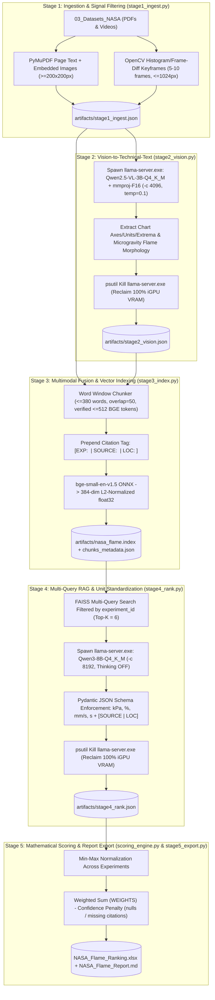
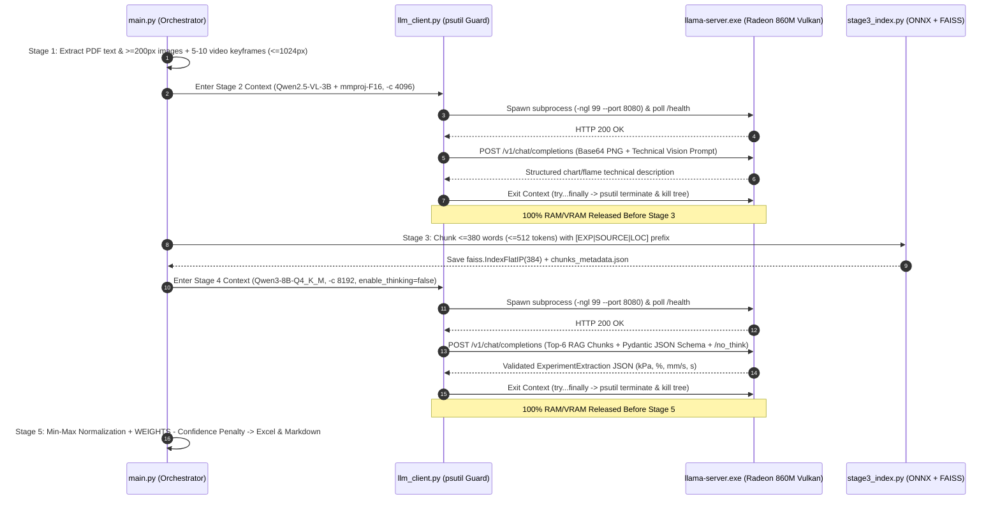

# FLAME IN FREEFALL — PIPELINE ARCHITECTURE & OPERATIONAL FLOW

## 1. Executive Hardware & Memory Status
- **Host RAM**: `23.1 GB Total` (`5.4 GB Available`)
- **Accelerator**: `AMD Radeon 860M iGPU (Vulkan Backend via llama-server.exe -ngl 99)`
- **Vector Engine**: `ONNX Runtime CPU + FAISS IndexFlatIP(384) (Cosine Similarity on L2 Vectors)`

### Model Weights & Runtime Readiness
| Component                   | Artifact Filename                  | Hardware Backend       | Readiness          |
|-----------------------------|------------------------------------|------------------------|--------------------|
| VLM Backbone (3B Q4_K_M)    | Qwen2.5-VL-3B-Instruct-Q4_K_M.gguf | iGPU Vulkan (-ngl 99)  | READY (1,840.5 MB) |
| VLM Projector (FP16 ViT)    | mmproj-F16.gguf                    | iGPU Vulkan (--mmproj) | READY (1,276.4 MB) |
| Embedding Bi-Encoder (ONNX) | model_optimized.onnx               | CPU ONNX Runtime       | READY (63.4 MB)    |
| Embedding Tokenizer         | tokenizer.json                     | CPU Fast Tokenizer     | READY (0.7 MB)     |
| Reasoning LLM (8B Q4_K_M)   | Qwen3-8B-Q4_K_M.gguf               | iGPU Vulkan (-ngl 99)  | READY (4,794.9 MB) |
| Llama Server Runtime        | llama-server.exe                   | Vulkan Backend Process | READY (0.0 MB)     |

---

## 2. 5-Stage Pipeline Architecture Matrix

| Stage   | Module                                 | Input                                   | Output                                         | Model / Engine                                    | Hardware Target                       | RAM Budget                          | Checkpoint Status   |
|---------|----------------------------------------|-----------------------------------------|------------------------------------------------|---------------------------------------------------|---------------------------------------|-------------------------------------|---------------------|
| Stage 1 | `stage1_ingest.py`                     | 03_Datasets_NASA (PDFs & Videos)        | stage1_ingest.json + PNGs (<=1024px)           | PyMuPDF (>=200x200px) + OpenCV Hist-Diff          | CPU Multi-Core                        | ~0.5 GB RAM                         | READY               |
| Stage 2 | `stage2_vision.py`                     | stage1_ingest.json (VisualAssets)       | stage2_vision.json (VisualDescriptions)        | Qwen2.5-VL-3B-Q4_K_M + mmproj-F16 (-c 4096)       | AMD Radeon 860M iGPU (Vulkan -ngl 99) | ~3.4 GB Shared VRAM (Freed on Exit) | PENDING             |
| Stage 3 | `stage3_index.py`                      | stage1_ingest.json + stage2_vision.json | nasa_flame.index + chunks_metadata.json        | BAAI/bge-small-en-v1.5 ONNX (384-dim, <=512 tok)  | CPU ONNX Runtime + FAISS IndexFlatIP  | ~0.4 GB RAM                         | PENDING             |
| Stage 4 | `stage4_rank.py`                       | FAISS Top-K (K=6) per experiment_id     | stage4_rank.json (Normalized SI Units)         | Qwen3-8B-Q4_K_M (-c 8192, /no_think, JSON Schema) | AMD Radeon 860M iGPU (Vulkan -ngl 99) | ~5.6 GB Shared VRAM (Freed on Exit) | PENDING             |
| Stage 5 | `scoring_engine.py + stage5_export.py` | stage4_rank.json                        | NASA_Flame_Ranking.xlsx + NASA_Flame_Report.md | Min-Max Normalization + WEIGHTS - Penalty         | CPU Deterministic Math Engine         | ~0.2 GB RAM                         | PENDING             |

---

## 3. End-to-End Multimodal Dataflow Diagram (Mermaid)

---

## 4. Process Lifecycle & VRAM Guard Sequence Diagram

---

## 5. Detailed Algorithmic Explanation by Stage (Jury Presentation Guide)

1. **Stage 1 (`stage1_ingest.py`) — Noise Filtering & Keyframe Detection**:
   - Groups raw NASA documents in `03_Datasets_NASA` by `experiment_id`.
   - Uses `PyMuPDF` to extract page-indexed text and filters out logos/icons by enforcing `width >= 200px` and `height >= 200px`.
   - Uses `OpenCV` Bhattacharyya histogram distance combined with mean absolute pixel difference to isolate `5`–`10` peak combustion transition keyframes (ignition, steady spherical burn, radiative extinction) without frame-by-frame redundancy. All visuals are Lanczos-resized so the longest edge is `<= 1024px`.
2. **Stage 2 (`stage2_vision.py`) — High-Precision Multimodal Transcription**:
   - Launches `Qwen2.5-VL-3B-Instruct-Q4_K_M.gguf` paired with `mmproj-F16.gguf` (`-ngl 99`, `-c 4096`, `temperature = 0.1`). Keeping the ViT projector in FP16 preserves fine chart tick marks and flame boundary gradients.
   - Transcribes plots (axes, units, min/max extrema) and flame photographs (color, spherical symmetry, soot shells) while preserving `experiment_id`, `source_file`, and `page_or_sec`, then terminates `llama-server.exe` via `psutil`.
3. **Stage 3 (`stage3_index.py`) — Traceable Chunking & 384-D Cosine Indexing**:
   - Fuses Stage 1 PDF text and Stage 2 VLM descriptions into a single corpus.
   - Splits text into windows of `<= 380` words (`50`-word overlap), prepends `[EXP: <id> | SOURCE: <file> | LOC: <page/sec>]` to every chunk, and verifies via `tokenizer.json` that no chunk exceeds `512` tokens.
   - Encodes chunks with `bge-small-en-v1.5` (`model_optimized.onnx`) into L2-normalized `384`-dimensional `float32` vectors and stores them in `faiss.IndexFlatIP(384)` (exact Inner Product = Cosine Similarity).
4. **Stage 4 (`stage4_rank.py`) — Multi-Query RAG & Unit Standardization**:
   - Queries FAISS across 3 domain-specific combustion probes filtered by `experiment_id` to retrieve Top-K (`K = 6`) chunks.
   - Runs `Qwen3-8B-Q4_K_M.gguf` (`-ngl 99`, `-c 8192`, `temperature = 0.1`) with thinking disabled (`--chat-template-kwargs "{\"enable_thinking\": false}"` and `/no_think`) and enforces `ExperimentExtraction` JSON Schema so all physical quantities are standardized (`kPa`, `%`, `mm/s`, `s`) with verifiable citations.
5. **Stage 5 (`scoring_engine.py` & `stage5_export.py`) — Mathematical Ranking & Export**:
   - Applies Min-Max normalization (`0..100`) across experiments for quantitative parameters, computes the weighted sum via `WEIGHTS`, and subtracts `confidence_penalty` (`-4.0` per missing physical field, `-10.0` if citations are missing).
   - Outputs `NASA_Flame_Ranking.xlsx` (2 formatted sheets) and `NASA_Flame_Report.md`.
