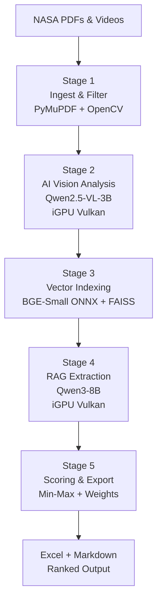

# Flame in Freefall — FreiFire

> **NASA Hackathon · AI Pipeline · Microgravity Combustion Analysis**

---

## One-Sentence Summary

> **Flame in Freefall** is a fully offline AI system running on a personal computer that automatically reads hundreds of pages of scientific documents and microgravity combustion experiment videos from NASA, extracts technical metrics, and ranks the experiments by relevance to space fire safety applications.

---

## The Problem Being Solved

NASA conducts dozens of material combustion experiments in **microgravity** aboard the International Space Station (ISS). Data from these experiments is stored as:

- **Technical PDF reports** spanning hundreds of pages, packed with charts, numerical tables, and flame imagery
- **Videos** capturing spherical flames floating inside combustion chambers

**The Problem:** Researchers spend countless hours manually reading documents to synthesize and compare results across experiments.

**Project Goal:** Use AI to automate the entire workflow—from document ingestion -> chart understanding -> metric extraction -> experiment ranking.

---

## Core Concept

The system mimics how a **research specialist** works, broken down into 5 sequential stages:

```text
NASA Documents -> Ingest & Filter -> Vision Understanding -> Vector Indexing -> AI Analysis -> Ranking
```

The entire pipeline runs **100% offline** on standard consumer hardware (no expensive discrete GPU or internet connection required).

---

## 5-Stage Architecture

### Stage 1 — Document Ingestion & Filtering (`stage1_ingest.py`)

**What it does:**  
Just like sitting down to read and bookmark key pages of a report, except the computer does it for you.

**Details:**
- **PDF:** Uses `PyMuPDF` to parse each page, extracting text and images. Filters out small graphics (logos, icons)—retaining only images $\ge 200 \times 200$ pixels (large enough to contain meaningful data).
- **Video:** Uses `OpenCV` to analyze frames and compute inter-frame differences, automatically selecting the 5–10 most critical "keyframes" (ignition, steady spherical burning, extinction)—eliminating manual frame-by-frame review.
- All images are resized to a maximum dimension of 1024px for faster AI inference.

**Output:** `stage1_ingest.json` — a structured catalog of all text and images organized by experiment.

---

### Stage 2 — AI Vision & Image Captioning (`stage2_vision.py`)

**What it does:**  
Like asking a domain expert to look at a chart and say: *"The X-axis is time (s), the Y-axis is pressure (kPa), and the peak value is 150 kPa..."*

**AI Model Used:**  
`Qwen2.5-VL-3B` — a multimodal vision-language model running on an integrated AMD Radeon 860M GPU via Vulkan.

**Details:**
- For **charts/plots:** The AI extracts axis labels, measurement units, and min/max values.
- For **flame imagery:** The AI describes flame color, spherical symmetry, and the presence of soot.
- Set to `temperature=0.1` -> ensures deterministic, accurate descriptions without random "creativity."
- Upon completion, **100% of VRAM is freed** via `psutil` so the next stage can utilize it.

**Output:** `stage2_vision.json` — detailed technical text descriptions for every extracted image.

---

### Stage 3 — Synthesis & Vector Indexing (`stage3_index.py`)

**What it does:**  
Like building a **smart reference library**—ask any question, and the system immediately pinpoints the most relevant passage.

**Details:**
1. **Data Merging:** Combines extracted PDF text (Stage 1) and AI-generated image descriptions (Stage 2) into a unified text corpus.
2. **Chunking:** Splits text into chunks of $\le 380$ words with a 50-word overlap to preserve context. Prepends a source-tracking tag to every chunk:
   ```text
   [EXP: EXP_FLEX_01 | SOURCE: 20150023456.pdf | LOC: page_76]
   ```
3. **Vector Embeddings:** Uses `bge-small-en-v1.5` (running via ONNX on CPU) to convert each text chunk into a 384-dimensional vector—acting as "semantic coordinates" in meaning space.
4. **FAISS Storage:** Stores all vectors in a high-speed FAISS vector database—retrieving the closest passages in milliseconds.

**Output:** `nasa_flame.index` + `chunks_metadata.json`

---

### Stage 4 — AI Analysis & Metric Extraction (`stage4_rank.py`)

**What it does:**  
Like having a specialist read the 6 most relevant document passages and fill out a standardized data sheet.

**AI Model Used:**  
`Qwen3-8B` — a larger 8-billion-parameter LLM running on GPU, optimized for reasoning and structured extraction.

**RAG (Retrieval-Augmented Generation) Workflow:**
1. For each experiment, the system queries FAISS with 3 domain-specific questions (covering chamber pressure, oxygen concentration, burn rate, etc.).
2. FAISS returns the **Top-6 most relevant passages** (filtered per experiment).
3. The AI reads those 6 passages and outputs standardized JSON, **strictly enforcing** the extraction of:
   - Chamber pressure (unit: **kPa**)
   - Oxygen concentration (unit: **%**)
   - Burn rate (unit: **mm/s**)
   - Burn duration (unit: **s**)
   - Source citations `[SOURCE | LOC]`

> [!NOTE]
> The LLM runs with `enable_thinking: false` + `/no_think` -> producing direct responses without verbose chain-of-thought overhead, saving both time and VRAM.

**Output:** `stage4_rank.json` — standardized technical metrics backed by verifiable source citations.

---

### Stage 5 — Scoring & Report Export (`scoring_engine.py` + `stage5_export.py`)

**What it does:**  
Scores each experiment using a transparent mathematical formula and exports human-readable reports.

**Scoring Formula:**

| Criterion | Weight | Description |
| :--- | :--- | :--- |
| Flame Stability | 25% | Spherical, symmetrical flame -> safer, predictable behavior |
| Fire Safety | 25% | Extinguishability and interaction with spacecraft materials |
| Data Completeness | 15% | More sensor readings yield higher confidence |
| Normalized Burn Rate | 15% | Min-Max scaling of burn rate |
| Normalized Burn Duration | 10% | Min-Max scaling of burn duration |
| Normalized Oxygen Margin | 10% | Min-Max scaling of oxygen concentration |

**Confidence Penalty Mechanism:**
- Each missing (`null`) data field: **-4 points**
- Missing source citation: **-10 points**
- Maximum penalty cap: **-35 points** (prevents unbounded negative scores)

**Key Feature — Environment Relevance Score:**  
The system evaluates suitability across 3 spaceflight environments based on pressure and oxygen concentration:
- **ISS / Space Station** ($101.35\text{ kPa}$, $21\%\ \text{O}_2$)
- **Lunar Base / Rover** ($\le 70.33\text{ kPa}$, $\ge 30\%\ \text{O}_2$)
- **EVA Suit / Spacesuit** ($29.65\text{ kPa}$, $100\%\ \text{O}_2$)

**Outputs:**
- `NASA_Flame_Ranking.xlsx` — 2-sheet Excel workbook: Overall Ranking + Experiment Details
- `NASA_Flame_Report.md` — Comprehensive Markdown report with full source citations

---

## Hardware & Memory Optimization

| Component | Details |
| :--- | :--- |
| CPU | Multi-core (Stages 1, 3, 5) |
| GPU | AMD Radeon 860M iGPU (Vulkan backend) |
| System RAM | 23.1 GB |
| VRAM | Shared with system memory |

> [!IMPORTANT]
> **Biggest Bottleneck:** Integrated GPUs have tightly constrained VRAM (shared with system RAM), making it impossible to load two AI models simultaneously.
>
> **Solution:** Immediately after each AI stage completes, the system **terminates the `llama-server.exe` process** via `psutil`, reclaiming 100% of VRAM before spinning up the next model.

```text
Stage 2 (VLM 3B) finishes -> psutil kill -> Frees ~3.4 GB VRAM
Stage 4 (LLM 8B) finishes -> psutil kill -> Frees ~5.6 GB VRAM
```

---

## Project File Structure

```text
NSA/
└── 04_Source_Code/
    ├── main.py                  # Orchestrates all 5 pipeline stages
    ├── config.py                # Path configurations & hyperparameters
    ├── schemas.py               # Pydantic data models (ExperimentExtraction, ScoredExperiment)
    ├── llm_client.py            # llama-server lifecycle management (psutil guard)
    ├── stage1_ingest.py         # Stage 1: PDF + Video ingestion
    ├── stage2_vision.py         # Stage 2: VLM image analysis
    ├── stage3_index.py          # Stage 3: Chunking + FAISS indexing
    ├── stage4_rank.py           # Stage 4: RAG + LLM extraction
    ├── stage5_export.py         # Stage 5: Excel + Report export
    ├── scoring_engine.py        # Scoring & relevance calculation engine
    ├── pipeline_visualizer.py   # Pipeline architecture visualizer
    ├── ARCHITECTURE.md          # Full technical documentation
    ├── PIPELINE_FLOW.md         # Data flow diagrams
    └── artifacts/
        ├── stage1_ingest.json   # Stage 1 checkpoint
        ├── stage2_vision.json   # Stage 2 checkpoint
        ├── nasa_flame.index     # FAISS vector index
        ├── chunks_metadata.json # Text chunk metadata
        ├── stage4_rank.json     # Stage 4 checkpoint
        ├── stage5_scored.json   # Final scored results
        ├── NASA_Flame_Ranking.xlsx  # Excel report
        └── NASA_Flame_Report.md     # Markdown report
```

---

## Sample Results

From a completed run of `NASA_Flame_Report.md`:

| Rank | Experiment | Fuel | Pressure | $\text{O}_2$ | Burn Rate | Score |
| :--- | :--- | :--- | :--- | :--- | :--- | :--- |
| **#1** | `EXP_FLEX_01` | n-Heptane | $101.33\text{ kPa}$ | $20\%$ | $1.2\text{ mm/s}$ | **94.70/100** |

**Environment Relevance Scores:**
- ISS: **99.56/100** (best match)
- Lunar Base: **81.15/100**
- EVA Suit: **44.59/100**

---

## End-to-End Data Flow



---

## How to Run

```bash
# Run the full pipeline
python main.py

# Ignore saved checkpoints and run from scratch
python main.py --force

# Display the architecture diagram
python main.py --describe
```

---

## Key Technical Highlights

| Strength | Details |
| :--- | :--- |
| **100% Offline Execution** | No paid APIs or internet connection required |
| **Checkpoint System** | Resumes seamlessly from the last completed stage if interrupted |
| **Strict VRAM Management** | `psutil` guarantees 100% VRAM release between model stages |
| **Automated Source Citations** | Every metric includes `[SOURCE | LOC]` for instant verification |
| **Pydantic Schema Enforcement** | Prevents unit hallucination by enforcing strict JSON schemas |
| **Multi-Query RAG** | 3 domain-specific queries per experiment -> higher recall and accuracy |
| **Consumer Hardware Friendly** | Runs smoothly on standard laptops with AMD Radeon iGPUs—no discrete GPU needed |
