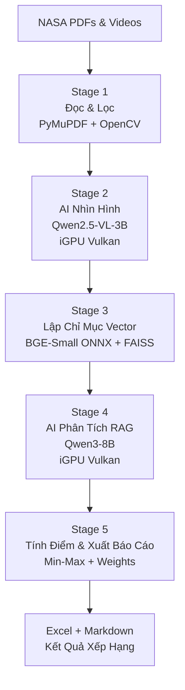

# Flame in Freefall — FreiFire

> **NASA Hackathon · AI Pipeline · Microgravity Combustion Analysis**

---

## Tóm tắt một câu

> **Flame in Freefall** là một hệ thống AI chạy hoàn toàn offline trên máy tính cá nhân, tự động đọc hàng trăm trang tài liệu khoa học & video thí nghiệm cháy nổ trong không trọng lực của NASA, trích xuất dữ liệu kỹ thuật, và xếp hạng các thí nghiệm theo độ quan trọng với ứng dụng an toàn cháy nổ ngoài vũ trụ.

---

## Vấn đề đang giải quyết

NASA thực hiện hàng chục thí nghiệm đốt cháy vật liệu trong môi trường **không trọng lực (microgravity)** trên Trạm Vũ Trụ Quốc Tế (ISS). Dữ liệu từ các thí nghiệm này được lưu trữ dưới dạng:

- **PDF báo cáo kỹ thuật** dày hàng trăm trang, chứa đầy biểu đồ, số liệu, hình ảnh ngọn lửa
- **Video** quay cảnh ngọn lửa hình cầu trôi nổi trong buồng thí nghiệm

**Vấn đề:** Các nhà nghiên cứu tốn rất nhiều giờ đọc thủ công để tổng hợp và so sánh kết quả giữa các thí nghiệm.

**Mục tiêu của dự án:** Dùng AI để tự động hóa toàn bộ quá trình này, từ đọc tài liệu → hiểu biểu đồ → trích xuất số liệu → xếp hạng thí nghiệm.

---

## Ý tưởng cốt lõi

Hệ thống mô phỏng cách một **chuyên gia nghiên cứu** làm việc, chia thành 5 bước nối tiếp nhau:

```
Tài liệu NASA → Đọc & Lọc → Hiểu Hình Ảnh → Lập Chỉ Mục → Phân Tích AI → Xếp Hạng
```

Toàn bộ pipeline chạy **100% offline** trên máy tính thông thường (không cần GPU rời đắt tiền, không cần internet).

---

## Kiến Trúc 5 Giai Đoạn

### Giai Đoạn 1 — Đọc & Lọc Tài Liệu (`stage1_ingest.py`)

**Làm gì:**  
Giống như bạn đang ngồi đọc và đánh dấu trang tài liệu, nhưng máy tính làm thay.

**Cụ thể:**
- **PDF:** Dùng `PyMuPDF` để đọc từng trang, trích text và hình ảnh. Lọc bỏ ảnh nhỏ (logo, icon) — chỉ giữ ảnh có kích thước ≥ 200×200 pixel (đủ lớn để chứa thông tin thực sự).
- **Video:** Dùng `OpenCV` phân tích từng frame, tính độ khác biệt giữa các frame để tự động chọn ra 5–10 "keyframe" quan trọng nhất (thời điểm bắt lửa, cháy ổn định hình cầu, tắt lửa) — không cần xem từng frame thủ công.
- Tất cả ảnh được resize về kích thước tối đa 1024px để AI xử lý nhanh hơn.

**Kết quả:** `stage1_ingest.json` — danh sách toàn bộ text và hình ảnh đã được tổ chức theo từng thí nghiệm.

---

### Giai Đoạn 2 — AI Nhìn & Mô Tả Hình Ảnh (`stage2_vision.py`)

**Làm gì:**  
Giống như bạn nhờ một chuyên gia nhìn vào biểu đồ và nói: *"Trục X là thời gian (s), trục Y là áp suất (kPa), giá trị cao nhất là 150 kPa..."*

**Model AI sử dụng:**  
`Qwen2.5-VL-3B` — một AI đa phương thức (nhìn được hình ảnh) chạy trên GPU tích hợp AMD Radeon 860M qua Vulkan.

**Cụ thể:**
- Với **biểu đồ:** AI đọc tên trục, đơn vị đo, giá trị min/max.
- Với **ảnh ngọn lửa:** AI mô tả màu sắc ngọn lửa, hình dạng có cân đối cầu không, có xuất hiện bồ hóng (soot) hay không.
- Nhiệt độ `temperature=0.1` → AI trả lời chính xác, không "sáng tạo" ngẫu nhiên.
- Sau khi xong, **giải phóng 100% VRAM** bằng `psutil` để giai đoạn sau dùng.

**Kết quả:** `stage2_vision.json` — mô tả kỹ thuật bằng chữ cho mọi hình ảnh.

---

### Giai Đoạn 3 — Tổng Hợp & Lập Chỉ Mục Vector (`stage3_index.py`)

**Làm gì:**  
Giống như xây dựng một **thư viện tra cứu siêu thông minh** — bạn hỏi gì, hệ thống tìm ngay đoạn văn bản liên quan nhất.

**Cụ thể:**
1. **Gộp dữ liệu:** Kết hợp text từ PDF (Giai đoạn 1) và mô tả hình ảnh từ AI (Giai đoạn 2) thành một kho văn bản thống nhất.
2. **Chia đoạn (Chunking):** Cắt văn bản thành các đoạn ≤380 từ, chồng lấp 50 từ để không mất ngữ cảnh. Thêm nhãn truy xuất nguồn vào đầu mỗi đoạn:
   ```
   [EXP: EXP_FLEX_01 | SOURCE: 20150023456.pdf | LOC: page_76]
   ```
3. **Tạo vector embedding:** Dùng model `bge-small-en-v1.5` (chạy ONNX trên CPU) để biến mỗi đoạn văn thành một vector 384 chiều — giống như "tọa độ ý nghĩa" trong không gian ngữ nghĩa.
4. **Lưu vào FAISS:** Toàn bộ vector được lưu vào cơ sở dữ liệu tìm kiếm siêu nhanh FAISS — tìm đoạn văn gần nhất chỉ trong mili-giây.

**Kết quả:** `nasa_flame.index` + `chunks_metadata.json`

---

### Giai Đoạn 4 — AI Phân Tích & Trích Xuất Số Liệu (`stage4_rank.py`)

**Làm gì:**  
Giống như nhờ một chuyên gia đọc 6 đoạn tài liệu liên quan nhất và điền vào một biểu mẫu chuẩn hóa.

**Model AI sử dụng:**  
`Qwen3-8B` — LLM lớn hơn (8 tỷ tham số) chạy trên GPU, tối ưu cho suy luận.

**Quy trình RAG (Retrieval-Augmented Generation):**
1. Với mỗi thí nghiệm, hệ thống đặt 3 câu hỏi chuyên ngành (về áp suất, oxy, tốc độ cháy...) vào FAISS.
2. FAISS trả về **Top-6 đoạn văn liên quan nhất** (theo từng thí nghiệm).
3. AI đọc 6 đoạn đó và trả về JSON chuẩn hóa, **bắt buộc** phải có:
   - Áp suất buồng thí nghiệm (đơn vị: **kPa**)
   - Nồng độ oxy (đơn vị: **%**)
   - Tốc độ cháy (đơn vị: **mm/s**)
   - Thời gian cháy (đơn vị: **s**)
   - Trích dẫn nguồn `[SOURCE | LOC]`

> [!NOTE]
> AI chạy ở chế độ `enable_thinking: false` + `/no_think` → phản hồi trực tiếp, không "suy nghĩ dài dòng", tiết kiệm thời gian và VRAM.

**Kết quả:** `stage4_rank.json` — dữ liệu kỹ thuật chuẩn hóa, có trích dẫn nguồn.

---

### Giai Đoạn 5 — Tính Điểm & Xuất Báo Cáo (`scoring_engine.py` + `stage5_export.py`)

**Làm gì:**  
Chấm điểm từng thí nghiệm dựa trên công thức toán học minh bạch, rồi xuất báo cáo.

**Công thức điểm:**

| Tiêu chí | Trọng số | Giải thích |
|---|---|---|
| Flame Stability (Độ ổn định ngọn lửa) | 25% | Ngọn lửa hình cầu, cân đối → an toàn |
| Fire Safety (An toàn cháy nổ) | 25% | Khả năng dập tắt, hành vi với vật liệu tàu vũ trụ |
| Data Completeness (Độ đầy đủ dữ liệu) | 15% | Càng nhiều sensor, dữ liệu càng tin cậy |
| Burn Rate chuẩn hóa | 15% | Min-Max scaling tốc độ cháy |
| Burn Duration chuẩn hóa | 10% | Min-Max scaling thời gian cháy |
| Oxygen Margin chuẩn hóa | 10% | Min-Max scaling nồng độ oxy |

**Cơ chế phạt (Confidence Penalty):**
- Mỗi trường dữ liệu bị thiếu (null): **-4 điểm**
- Không có trích dẫn nguồn: **-10 điểm**
- Phạt tối đa: **-35 điểm** (không âm vô hạn)

**Điểm đặc biệt — Relevance Score (Điểm phù hợp môi trường):**  
Hệ thống tính điểm phù hợp với 3 môi trường vũ trụ dựa vào áp suất và nồng độ oxy:
- **ISS / Trạm Vũ Trụ** (101.35 kPa, 21% O2)
- **Căn cứ Mặt Trăng / Rover** (≤70.33 kPa, ≥30% O2)
- **Bộ đồ EVA / Spacesuit** (29.65 kPa, 100% O2)

**Kết quả xuất ra:**
- `NASA_Flame_Ranking.xlsx` — Excel 2 sheet: Bảng xếp hạng + Chi tiết từng thí nghiệm
- `NASA_Flame_Report.md` — Báo cáo markdown đầy đủ, có trích dẫn nguồn

---

## 💾 Phần Cứng & Tối Ưu Bộ Nhớ

| Thành phần | Chi tiết |
|---|---|
| CPU | Multi-core (Stage 1, 3, 5) |
| GPU | AMD Radeon 860M iGPU (Vulkan backend) |
| RAM hệ thống | 23.1 GB |
| VRAM | Dùng chung với RAM (shared memory) |

> [!IMPORTANT]
> **Vấn đề lớn nhất:** GPU tích hợp có VRAM rất giới hạn (dùng chung với RAM). Không thể chạy 2 model AI cùng lúc.
>
> **Giải pháp:** Mỗi khi xong một giai đoạn dùng AI, hệ thống **giết tiến trình `llama-server.exe` ngay lập tức** bằng `psutil`, giải phóng 100% VRAM trước khi khởi động model tiếp theo.

```
Stage 2 (VLM 3B) chạy xong → psutil kill → Giải phóng ~3.4 GB VRAM
Stage 4 (LLM 8B) chạy xong → psutil kill → Giải phóng ~5.6 GB VRAM
```

---

## Cấu Trúc File Dự Án

```
NSA/
└── 04_Source_Code/
    ├── main.py                  # Điều phối toàn bộ 5 giai đoạn
    ├── config.py                # Cấu hình đường dẫn & hyperparameter
    ├── schemas.py               # Pydantic data models (ExperimentExtraction, ScoredExperiment)
    ├── llm_client.py            # Quản lý vòng đời llama-server (psutil guard)
    ├── stage1_ingest.py         # Giai đoạn 1: Đọc PDF + Video
    ├── stage2_vision.py         # Giai đoạn 2: VLM phân tích hình ảnh
    ├── stage3_index.py          # Giai đoạn 3: Chunking + FAISS indexing
    ├── stage4_rank.py           # Giai đoạn 4: RAG + LLM trích xuất
    ├── stage5_export.py         # Giai đoạn 5: Xuất Excel + Report
    ├── scoring_engine.py        # Thuật toán tính điểm
    ├── pipeline_visualizer.py   # Visualize kiến trúc pipeline
    ├── ARCHITECTURE.md          # Tài liệu kỹ thuật đầy đủ
    ├── PIPELINE_FLOW.md         # Sơ đồ luồng dữ liệu
    └── artifacts/
        ├── stage1_ingest.json   # Checkpoint Giai đoạn 1
        ├── stage2_vision.json   # Checkpoint Giai đoạn 2
        ├── nasa_flame.index     # FAISS vector index
        ├── chunks_metadata.json # Metadata các đoạn văn
        ├── stage4_rank.json     # Checkpoint Giai đoạn 4
        ├── stage5_scored.json   # Kết quả điểm cuối
        ├── NASA_Flame_Ranking.xlsx  # Báo cáo Excel
        └── NASA_Flame_Report.md     # Báo cáo Markdown
```

---

## Kết Quả Thực Tế

Từ file `NASA_Flame_Report.md` đã chạy:

| Rank | Thí nghiệm | Nhiên liệu | Áp suất | O2 | Tốc độ cháy | Điểm |
|---|---|---|---|---|---|---|
| **#1** | `EXP_FLEX_01` | n-Heptane | 101.33 kPa | 20% | 1.2 mm/s | **94.70/100** |

**Điểm phù hợp môi trường:**
- ISS: **99.56/100** (phù hợp nhất)
- Căn cứ Mặt Trăng: **81.15/100**
- Bộ đồ EVA: **44.59/100**

---

## Luồng Dữ Liệu Tổng Quan



---

## Cách Chạy

```bash
# Chạy toàn bộ pipeline
python main.py

# Bỏ qua checkpoint đã lưu, chạy lại từ đầu
python main.py --force

# Hiển thị sơ đồ kiến trúc
python main.py --describe
```

---

## Điểm Nổi Bật Kỹ Thuật

| Điểm mạnh | Chi tiết |
|---|---|
| **Chạy offline hoàn toàn** | Không cần API trả phí, không cần internet |
| **Checkpoint system** | Pipeline dừng giữa chừng vẫn tiếp tục được từ chỗ dừng |
| **VRAM management nghiêm ngặt** | `psutil` đảm bảo 100% giải phóng VRAM giữa các giai đoạn |
| **Trích dẫn nguồn tự động** | Mọi số liệu đều có `[SOURCE | LOC]` để verify |
| **Pydantic schema enforcement** | AI không được tự bịa đơn vị, phải trả JSON chuẩn |
| **Multi-query RAG** | 3 câu hỏi chuyên ngành cho mỗi thí nghiệm → kết quả toàn diện hơn |
| **Phù hợp hardware phổ thông** | Chạy được trên laptop AMD Radeon iGPU, không cần GPU rời |
